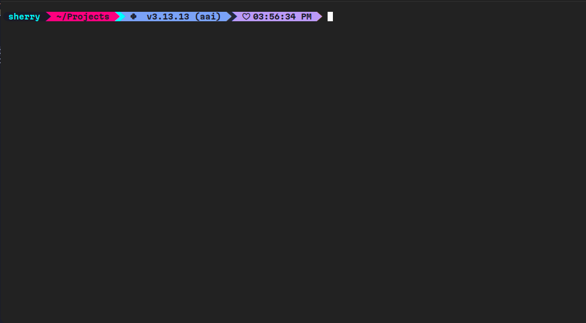
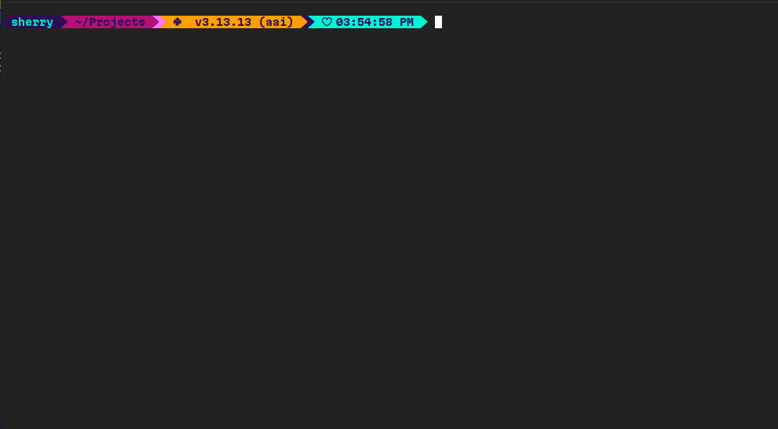

# 🚀 Cyberpunk Starship Themes

Welcome to your new highly customized, Powerline-style cyberpunk prompts for [Starship](https://starship.rs/). This guide will help you set up and switch between the **Neo-Tokyo** and **Synthwave** themes.

## 🛠️ Prerequisites
* [Starship](https://starship.rs/) installed on your system.
* A patched [Nerd Font](https://www.nerdfonts.com/) installed and configured in your terminal (required for the ``, ``, and custom icons to render perfectly).

---

## 🌃 1. Neo-Tokyo Cyberpunk Theme
A sleek, high-contrast aesthetic featuring dark night backgrounds transitioning into blazing hot pink, electric neon cyan, and deep twilight purple.

### Setup Instructions
1. Make the following file (if it doesn't already exist):

```bash
touch ~/.config/starship.toml
```

2. Open the file in your preferred text editor.
3. Paste the content of `neo-tokyo-cyberpunk.toml` into `~/.config/starship.toml`.
4. Save the file. Your prompt will update instantly!

### Preview



---

## 🌇 2. Synthwave / Outrun Cyberpunk Theme

A retro-futuristic, glowing grid aesthetic featuring deep night purples, blazing magentas, neon hot pinks, radioactive oranges, and bright teals.

### Setup Instructions

1. Make the following file (if it doesn't already exist):
```bash
touch ~/.config/starship.toml
```

2. Open the file in your preferred text editor.
3. Paste the content of `synthwave-cyberpunk.toml` into `~/.config/starship.toml`.
4. Save the file. Your prompt will update instantly!

### Preview



---

## License

This project is licensed under the MIT License - see the [LICENSE](LICENSE) file for details.
